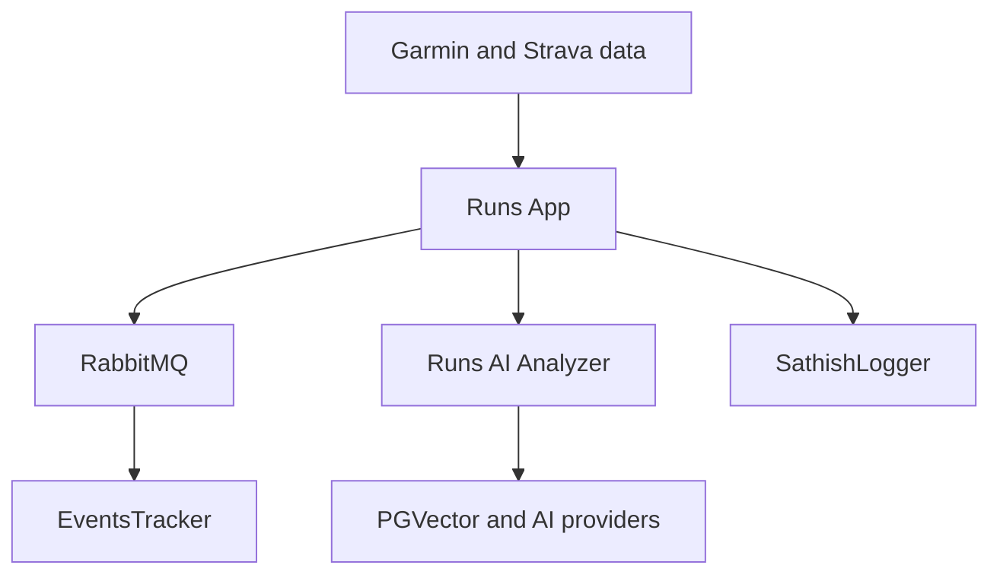

# Sathish Jayapal

**Enterprise & Cloud Architect | Distributed Systems | Platform Engineering | Applied AI**

I connect architecture decisions to working software.

My work in enterprise and cloud architecture shapes the questions I explore here: how services behave when dependencies fail, how data stays consistent across boundaries, how platforms reduce operational friction, and how teams understand the systems they run.

These repositories are my personal engineering lab. I build, deploy, and operate applications to make those questions concrete—and write about the decisions, tradeoffs, and lessons along the way.

## Start here

| Project | What it demonstrates |
| --- | --- |
| **[Runs App](https://github.com/sathishjayapal/runs-app)** | My flagship application: Garmin and Strava data, a Java/Spring Boot backend, React frontend, PostgreSQL, messaging, and automated delivery. |
| **[EventsTracker](https://github.com/sathishjayapal/eventstracker)** | Event ingestion and RabbitMQ choreography, with experiments in distributed coordination and service operations. |
| **[Runs AI Analyzer](https://github.com/sathishjayapal/runs-ai-analyzer)** | Applied AI over running data using Spring AI, PGVector, embeddings, semantic caching, and asynchronous analysis. |
| **[consolidated-postgres](https://github.com/sathishjayapal/consolidated-postgres)** | Shared infrastructure and deployment configuration for the lab: PostgreSQL, RabbitMQ, environment mappings, and startup verification. |
| **[iAC-NikeRuns](https://github.com/sathishjayapal/iAC-NikeRuns)** | Infrastructure as code across AWS and Azure, including Terraform experiments and the constraints of temporary cloud environments. |

Supporting service: **[SathishLogger](https://github.com/sathishjayapal/sathish-projects-logger)**—centralized application logging and correlation IDs.

## Architecture questions I explore

- **Resilience:** What happens when a dependency is unavailable, a request is retried, or a message arrives twice?
- **Consistency:** Where should a transaction boundary end, and how should services coordinate beyond it?
- **Platform engineering:** Which capabilities should services share, and where does centralization introduce coupling?
- **Observability:** Can I follow a request across services and explain why it failed?
- **Deployment portability:** What changes when a workload moves between a laptop, a server, and a cloud environment?
- **Applied AI:** When does retrieval or semantic caching help, and how should a system handle stale context?

## One lab, connected services

The projects increasingly form one small distributed system. This diagram is a simplified view of the relationships I explore:

The lab also uses shared PostgreSQL infrastructure and Docker/Portainer deployments. It gives me a place to work through configuration drift, persistent data, startup dependencies, container portability, and delivery automation.

These are personal projects at lab scale. I document the operating constraints and unfinished work alongside the implementation.

## Tools I work with

| Area | Technologies |
| --- | --- |
| Application development | Java, Spring Boot, React, TypeScript, REST APIs |
| Data and messaging | PostgreSQL, RabbitMQ, Flyway, PGVector |
| Cloud and infrastructure | AWS, Azure, Terraform, Docker, Kubernetes, Portainer |
| Software delivery | GitHub Actions, Testcontainers, automated testing, static analysis, container scanning |
| Applied AI | Spring AI, Anthropic, Ollama, embeddings, semantic caching |

## Why running?

I'm a marathon runner, and running gives this lab a domain I care about and continuously generate data for.

Imports fail. Activities get duplicated. Devices disagree. Training context changes. Those practical problems give me reasons to explore retries, data quality, asynchronous processing, and the limits of AI analysis.

Running is the domain; architecture and engineering are the recurring themes.

## Writing and connection

I write about the point where architecture diagrams meet implementation and operation:

- **[Personal blog — sathishjayapal.com](https://sathishjayapal.com)**
- **[Technical articles on Medium — @dotsky](https://dotsky.medium.com)**

For a project question or collaboration idea, open an issue in the relevant repository.

Based in **Wisconsin, USA**.

**Build → operate → observe → learn → redesign.**

