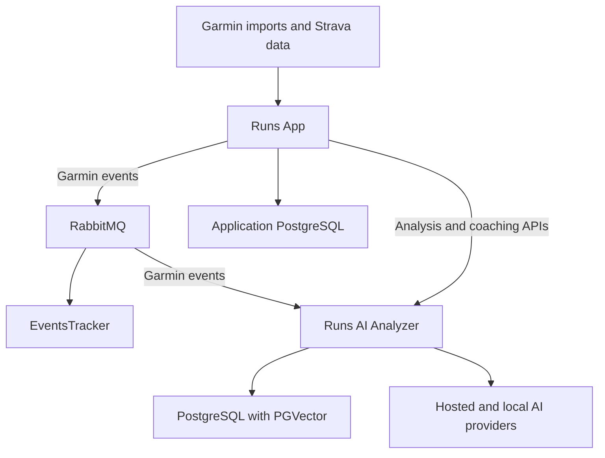

# Sathish Jayapal

**Enterprise & Cloud Architect | Distributed Systems | Platform Engineering | Applied AI**

I connect architecture decisions to working software.

I build and operate a connected engineering lab to explore resilience, data consistency, observability, and the practical tradeoffs of hosted and local AI. My enterprise architecture work shapes the questions; these personal projects give me a place to test the answers.

I document the decisions, failures, and operational lessons along the way.

## Start here

| Project | What it demonstrates |
| --- | --- |
| **[Runs App](https://github.com/sathishjayapal/runs-app)** | My flagship running application: Garmin imports and Strava activity data, a Java/Spring Boot backend, React frontend, PostgreSQL, RabbitMQ events, and an AI coaching interface. Includes an isolated demo with synthetic data. |
| **[Runs AI Analyzer](https://github.com/sathishjayapal/runs-ai-analyzer)** | AI coaching grounded in stored running analyses and journal entries, using Spring AI, PGVector, semantic retrieval, caching, and asynchronous event processing. |
| **[EventsTracker](https://github.com/sathishjayapal/eventstracker)** | Event ingestion and tracking with RabbitMQ and PostgreSQL, exploring service coordination and operational visibility. |
| **[consolidated-postgres](https://github.com/sathishjayapal/consolidated-postgres)** | Shared infrastructure orchestration, per-project databases, environment configuration, startup verification, and documented server operations. |
| **[iAC-NikeRuns](https://github.com/sathishjayapal/iAC-NikeRuns)** | Infrastructure-as-code experiments across AWS and Azure, including Terraform and temporary cloud environments. |

## What I am working through

### Resilience across service boundaries

Running data, event delivery, and AI inference fail in different ways. I explore retries, duplicate handling, reconciliation, dependency failures, and the boundaries between a successful import and a completed analysis.

The recurring question: **How does useful work continue when one dependency is unavailable?**

### AI with context and visible tradeoffs

The analyzer combines recent analyses with relevant stored analyses and journal entries to answer running questions. Recent work includes:

- Coaching answers with source references limited to context actually included in the prompt.
- Hosted and local model fallback, with per-provider circuit breakers.
- Daily call limits, prompt budgets, and bounded response sizes.
- UI explanations of which model answered and why another provider was skipped.
- Cache invalidation when running data changes.

The configured chat provider order is **OpenRouter → Anthropic → cloud-sandbox Ollama → local Ollama**, with unavailable or unconfigured tiers skipped. Embeddings use a separate configured Ollama endpoint.

### Operating the lab

The applications run in a self-hosted Ubuntu and Docker environment, with Portainer for container management. Operational work includes:

- Prometheus/Grafana monitoring, service probes, and alerting configuration.
- Loki/Alloy logging and correlation IDs across HTTP requests and RabbitMQ events.
- Startup and reboot recovery, backup automation, and recovery documentation.
- Host and Docker firewall rules, with Tailscale for remote administration.
- GitHub Actions pipelines for tests, container builds, and vulnerability scanning.

I treat these capabilities as ongoing engineering work: configuration in a repository is a starting point; behavior during failures and recovery is what needs verification.

## One lab, connected services

A simplified application view; supporting infrastructure and deployment details live in the individual repositories.

The projects share infrastructure orchestration while maintaining per-project databases. This gives me practical questions about configuration drift, startup dependencies, persistent data, and the coupling introduced by shared platform services.

## Tools I work with

| Area | Technologies |
| --- | --- |
| Application development | Java, Spring Boot, React, TypeScript, REST APIs |
| Data and messaging | PostgreSQL, RabbitMQ, Flyway, PGVector |
| Applied AI | Spring AI, OpenRouter, Anthropic, Ollama, retrieval-augmented generation, embeddings, caching |
| Resilience | Resilience4j, circuit breakers, retries, duplicate handling, reconciliation |
| Cloud and infrastructure | AWS, Azure, Terraform, Ubuntu, Docker, Portainer, Kubernetes |
| Observability and operations | Prometheus, Grafana, Loki, Alloy, service probes, systemd, Tailscale |
| Software delivery | GitHub Actions, Testcontainers, automated testing, static analysis, container scanning |

These repositories are personal projects at lab scale. Implemented features, experiments, and unfinished work are documented within each project; deployment status can differ from the latest source.

## Why running?

I am a marathon runner, and running gives this lab a domain I care about and continuously generate data for.

Imports fail. Activities get duplicated. Devices disagree. Training context changes. Those practical problems give me reasons to explore data quality, asynchronous processing, recovery, and the limits of AI coaching.

Running is the domain; architecture and engineering are the recurring themes.

## Writing and connection

I write about the point where architecture diagrams meet implementation and operation:

- **[Personal blog — sathishjayapal.com](https://sathishjayapal.com)**
- **[Technical articles on Medium — @dotsky](https://dotsky.medium.com)**

For a project question or collaboration idea, open an issue in the relevant repository.

Based in **Wisconsin**.

**Clarity is kindness.**

Build → operate → observe → learn → redesign.

